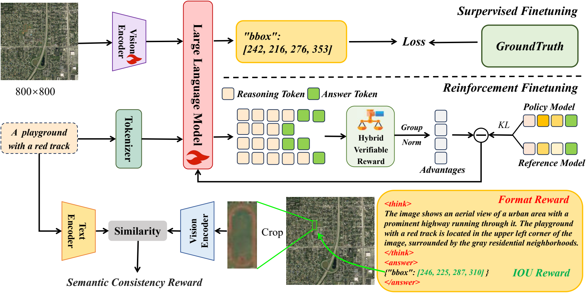
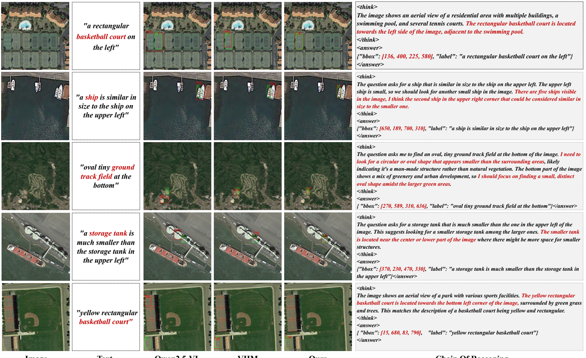

<div align="center">

# DeepGrounder

### Generalized Reasoning for MLLM-based Remote Sensing Visual Grounding

**IEEE Transactions on Geoscience and Remote Sensing (TGRS), 2026 · Accepted**

Jiafan Zhang · Keyan Chen · Chenyang Liu · Baihong Lin · Zhengxia Zou · Zhenwei Shi

[](https://ieeexplore.ieee.org/document/11538158)
[](https://doi.org/10.1109/TGRS.2026.3697769)
[](https://huggingface.co/Apollo-ULTA/DeepGrounder)
[](https://github.com/ZhanYang-nwpu/RSVG-pytorch)

[Paper](https://ieeexplore.ieee.org/document/11538158) · [Model weights](https://huggingface.co/Apollo-ULTA/DeepGrounder) · [Dataset](#dataset) · [Training guide](docs/TRAINING.md) · [Inference guide](docs/INFERENCE.md) · [Citation](#citation)


</div>

DeepGrounder localizes objects in remote sensing images from natural language descriptions. Built on **Qwen2.5-VL-3B-Instruct**, it follows a two-stage **learn-then-reason** strategy: supervised fine-tuning (SFT) establishes domain knowledge and spatial perception; reinforcement fine-tuning with group relative policy optimization (GRPO) improves structured spatial reasoning and generalization.

## Method



The hybrid verifiable reward combines **reasoning format**, **geometric localization**, and **vision-language semantic consistency**. Git-RSCLIP verifies whether the predicted image crop matches the referring expression. See Figure 3 and Section III of the [paper](https://ieeexplore.ieee.org/document/11538158).

- **Stage I — SFT:** language-side LoRA, rank 8 and alpha 32, with the vision encoder and multimodal projector frozen.
- **Stage II — GRPO:** full-parameter training from the merged SFT checkpoint, with eight sampled responses per query and hybrid rewards.
- **Generalization:** evaluation covers in-domain grounding, difficult semantic categories, and transfer to unseen data.

## Results

Values below are **reported in the paper** (Tables I–III); all metrics are percentages. They are not a new benchmark of the released checkpoint.

| Dataset / setting | Model | Pr@0.5 | Pr@0.7 | Pr@0.9 | oIoU | mIoU |
| --- | --- | ---: | ---: | ---: | ---: | ---: |
| DIOR-RSVG | Qwen2.5-VL-3B | 32.56 | 19.77 | 3.49 | 32.26 | 33.86 |
| DIOR-RSVG | SFT baseline | 47.90 | 23.00 | 4.40 | 54.17 | 42.55 |
| DIOR-RSVG | **DeepGrounder** | **64.03** | **48.27** | **14.35** | **66.39** | **54.85** |
| RRSIS-D | SFT baseline | 47.77 | 33.41 | 11.29 | 52.76 | 45.02 |
| RRSIS-D | **DeepGrounder** | **64.21** | **47.66** | **15.83** | **73.17** | **57.11** |
| VRSBench / zero-shot | **DeepGrounder** | **59.1** | **38.8** | — | — | — |

**Key findings.** On DIOR-RSVG, the full method improves Pr@0.5 by **16.13 percentage points** and mIoU by **12.30 points** over SFT alone. On VRSBench, zero-shot DeepGrounder exceeds the paper's VRSBench-supervised GeoChat comparison (57.4 / 22.6 at Pr@0.5 / Pr@0.7). The paper also finds larger gains on several difficult categories, supporting the benefit of reasoning-oriented post-training.

### Qualitative examples



**Figure 5, DIOR-RSVG.** Green boxes indicate ground truth; red boxes indicate predictions. Examples show attribute comparison, relative position, and contextual disambiguation.

## Quick start

For inference, use Python 3.10+ and a CUDA-capable PyTorch environment. Install PyTorch for your CUDA version first, then:

```bash
git clone https://github.com/ULTA-Web/DeepGrounder.git
cd DeepGrounder
pip install -r requirements-inference.txt

# Download the published checkpoint.
huggingface-cli download Apollo-ULTA/DeepGrounder \
  --local-dir checkpoints/DeepGrounder
```

The release contains a **complete Qwen2.5-VL model**, including two Safetensors shards and tokenizer/processor files; no separate LoRA merge is required for inference. Training provenance and checkpoint-to-table correspondence should be checked before using this checkpoint to reproduce a particular paper row.

## Dataset

This release's training and evaluation walkthrough uses **DIOR-RSVG**.

- **Official dataset project:** [ZhanYang-nwpu/RSVG-pytorch](https://github.com/ZhanYang-nwpu/RSVG-pytorch).
- **Official download:** [Google Drive — DIOR-RSVG](https://drive.google.com/drive/folders/1hTqtYsC6B-m4ED2ewx5oKuYZV13EoJp_?usp=sharing).
- **Official splits:** 26,991 train / 3,829 validation / 7,500 test referring expressions.
- Follow the dataset authors' research/noncommercial usage terms. Dataset rights are separate from model and code licensing.

Extract the files as follows:

```text
data/DIOR_RSVG/
├── Annotations/
├── JPEGImages/
├── train.txt
├── val.txt
└── test.txt
```

Convert the official annotations:

```bash
python tools/prepare_dior_rsvg.py \
  --data_root data/DIOR_RSVG \
  --output_dir data/processed/DIOR-RSVG
```

**Split IDs identify expressions, not image filenames.** The converter matches the official loader's sorted XML traversal and zero-based object enumeration, checks that splits are disjoint, and writes SFT, GRPO, and inference annotations. It preserves the source xyxy pixel coordinates. The paper additionally evaluates RRSIS-D and VRSBench; those experiments use their own datasets and protocols.

## Inference

From the repository root:

```bash
python src/eval/infer_allbox.py \
  --reasoning_model_path checkpoints/DeepGrounder \
  --json_path data/processed/DIOR-RSVG/test_eval.jsonl \
  --image_base_path data/DIOR_RSVG/JPEGImages \
  --output_dir outputs/DIOR-RSVG \
  --resize_size 840
```

The evaluator saves `metrics.json` and `error_cases.txt`. Invalid generated boxes count as failures. See the [inference guide](docs/INFERENCE.md) for input schemas, coordinate handling, and evaluation details.

## Training

Follow the [training guide](docs/TRAINING.md) for environment setup, DIOR-RSVG conversion, SFT registration, LoRA export, and GRPO launch commands.

```bash
# Linux / WSL2 + CUDA; install a compatible PyTorch build first.
bash setup.sh

# After training and exporting Stage I in LLaMA-Factory:
export MODEL_PATH=/absolute/path/to/Qwen2.5-VL-3B-DeepGrounder-DIOR-SFT
export IMAGE_ROOT=/absolute/path/to/DIOR_RSVG/JPEGImages
export DATA_CONFIG=/absolute/path/to/processed/DIOR-RSVG/dior_grpo.yaml
export DEEPGROUNDER_SEMANTIC_URL=http://127.0.0.1:5000
bash src/open-r1-multimodal/run_scripts/run_grpo_rec.sh
```

**Full hybrid training requires a Git-RSCLIP scoring service.** This repository contains its client; the service implementation is not bundled. The [training guide](docs/TRAINING.md#semantic-reward-service) documents its interface and a separately labeled format/geometric reward ablation. An unreachable or missing service must be resolved before claiming full-method reproduction.

## Repository guide

| Path | Purpose |
| --- | --- |
| [docs/TRAINING.md](docs/TRAINING.md) | SFT → merged checkpoint → GRPO workflow |
| [docs/INFERENCE.md](docs/INFERENCE.md) | Checkpoint download, input format, and metrics |
| [tools/prepare_dior_rsvg.py](tools/prepare_dior_rsvg.py) | Official DIOR-RSVG annotation conversion |
| [configs](configs) | LLaMA-Factory SFT, export, and dataset registration examples |
| [src/eval/infer_allbox.py](src/eval/infer_allbox.py) | Grounding evaluation entry point |
| [src/open-r1-multimodal](src/open-r1-multimodal) | GRPO training implementation |

## Citation

```bibtex
@article{zhang2026deepgrounder,
  title   = {DeepGrounder: Generalized Reasoning for MLLM-Based Remote Sensing Visual Grounding},
  author  = {Zhang, Jiafan and Chen, Keyan and Liu, Chenyang and Lin, Baihong and Zou, Zhengxia and Shi, Zhenwei},
  journal = {IEEE Transactions on Geoscience and Remote Sensing},
  year    = {2026},
  volume  = {64},
  doi     = {10.1109/TGRS.2026.3697769},
  url     = {https://ieeexplore.ieee.org/document/11538158}
}
```

Please also cite DIOR-RSVG when using that dataset:

```bibtex
@article{zhan2023rsvg,
  title   = {RSVG: Exploring Data and Models for Visual Grounding on Remote Sensing Data},
  author  = {Zhan, Yang and Xiong, Zhitong and Yuan, Yuan},
  journal = {IEEE Transactions on Geoscience and Remote Sensing},
  year    = {2023},
  volume  = {61},
  pages   = {1--13},
  doi     = {10.1109/TGRS.2023.3250471}
}
```

## Acknowledgments and licensing

We thank [VLM-R1](https://github.com/om-ai-lab/VLM-R1), [Open-R1](https://github.com/huggingface/open-r1), [Qwen2.5-VL](https://github.com/QwenLM/Qwen2.5-VL), [LLaMA-Factory](https://github.com/hiyouga/LLaMA-Factory), [TRL](https://github.com/huggingface/trl), and the DIOR-RSVG authors. The training subtree retains its [Apache-2.0 license](src/open-r1-multimodal/LICENSE) and upstream notices. Consult the model card and dataset authors for the terms applicable to weights and data.
